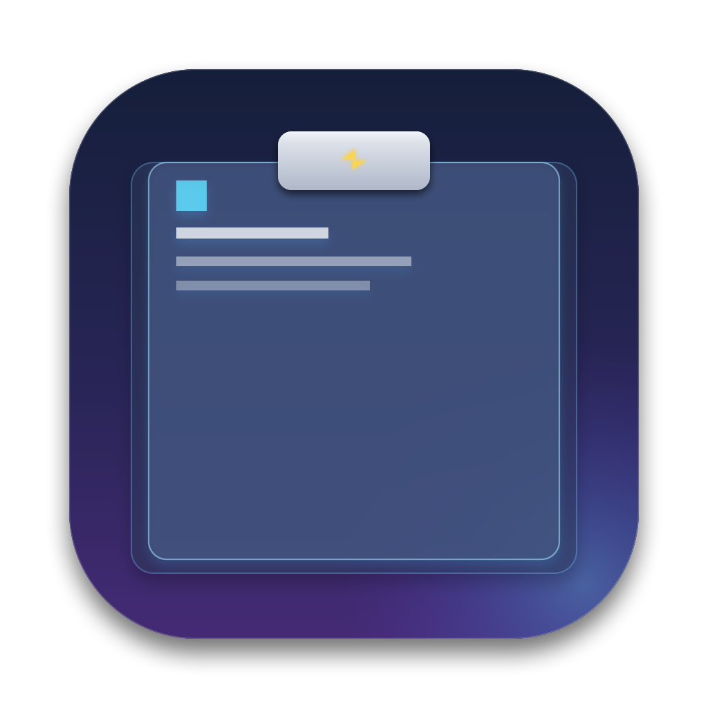

<div align="center">



# PasteFlow

**Next-Generation, Lightweight & Privacy-First Clipboard Manager for macOS & Windows**

[](https://github.com/lengo0951/PasteFlow/releases)
[](https://www.apple.com/macos/)
[](https://www.microsoft.com/windows)
[](https://swift.org)
[](https://www.rust-lang.org)
[](https://github.com/lengo0951/PasteFlow)
[](LICENSE)

*Crafted by [**Quốc Ngô**](https://github.com/lengo0951) (`@lengo0951` / `coolstar17`)*

[Download for macOS (DMG)](https://github.com/lengo0951/PasteFlow/releases/latest) • [Download for Windows (Zip)](https://github.com/lengo0951/PasteFlow/releases/latest) • [Key Features](#-key-features) • [Build from Source](#-build-from-source)

---

</div>

## 📖 Overview

**PasteFlow** is a native, ultra-lightweight clipboard manager engineered for developers, designers, and power users across **macOS and Windows**.

Unlike heavy Electron-based or webview-wrapped clipboard apps that easily consume 300MB – 1GB+ of memory, PasteFlow is built **100% natively**:
* **macOS:** Pure **Swift 6, SwiftUI, and AppKit** with native `NSVisualEffectView` materials.
* **Windows:** Pure **Rust 2024 and Win32 APIs (`windows-rs`)** with native Windows 11 **DWM Mica / Acrylic** blur.

PasteFlow runs silently in the background with near **0.0% CPU** and a microscopic **~20 MB – 33 MB resident memory (RSS)** footprint while providing fluid animations, frosted glass aesthetics, and instant preview capabilities.

---

## 🌟 Key Features

* 🎨 **Frosted Glassmorphism Floating Bar**:
  * Slides gracefully up from the bottom of your screen using native `NSVisualEffectView` materials.
  * Harmonizes naturally with macOS Sequoia and Sonoma, supporting both Light & Dark modes seamlessly.
* ⚡ **Ultra-Low Memory Footprint (~33 MB RAM)**:
  * Eliminates the uncompressed TIFF bitmap trap (which commonly inflates icon representations up to 98MB per clip).
  * Employs an intelligent thumbnail cache (`AppIconCache`) downscaled to 32×32 with LRU eviction.
  * Engineered from the ground up for minimal resource overhead, keeping your Mac fast and responsive.
* 🔍 **Instant Quick Look (`Spacebar`)**:
  * Tap **`Space`** on any highlighted card to trigger an expansive modal preview.
  * Preview full-resolution images, multi-line code snippets with syntax awareness, color swatches with HEX/RGB/SwiftUI values, and file lists.
* ⌨️ **Global Shortcut & Smart Pasting**:
  * **`⌘ + ⇧ + V`** (`Cmd + Shift + V`): Toggle the PasteFlow HUD anywhere instantly.
  * **`Return`**: Simulates `Cmd + V` directly into your active target application.
  * **`⌥ + Return`** (`Option + Return`): **Paste as Plain Text** — automatically strips rich text, formatting, styles, and unwanted markup.
  * **`1` .. `9`**: Instant single-key paste for the 9 most recent clipboard items.
* 🛡️ **Privacy-First & Self-Paste Protection**:
  * Automatically detects and suppresses clips from password managers (**1Password**, **Bitwarden**, **KeePassXC**, **Keychain Access**).
  * Prevents infinite clipboard feedback loops by tagging synthetic pastes with `org.nspasteboard.AutoGeneratedType`.
  * Excludes user-defined blacklisted applications.
* 🗂️ **Custom Pinboards**:
  * Organize snippets, recurring code blocks, commands, and links into colored boards (Code, Links, Colors, Snippets).
* 🚀 **Modern Launch at Login**:
  * Native integration with Apple's `SMAppService` API (macOS 13+), requiring no deprecated helper apps or launch daemons.

---

## 📊 Performance & Efficiency Benchmarks

All benchmarks were measured directly on macOS (Apple Silicon M-Series, macOS Sequoia) using Apple's native diagnostic utilities (`footprint`, `vmmap`, `ps`) and empirical execution profiling.

### ⚡ Resource Utilization (Live Metrics)

| Metric | PasteFlow (Native Swift 6) | Typical Electron / Webview App | Difference |
| :--- | :--- | :--- | :--- |
| **Idle Memory (RSS)** | **~31 MB** | 250 MB – 550 MB | **~90% less RAM** |
| **Active HUD Footprint** | **~45 MB** | 400 MB – 850 MB | **Up to 10× lighter** |
| **Background CPU** | **0.0%** | 0.8% – 2.5% | **Zero idle wakeups** |
| **Cold Launch Time** | **< 35 ms** | 1,200 ms – 3,500 ms | **Instantaneous** |
| **HUD Popup Latency** | **< 5 ms** | 120 ms – 280 ms | **Frame-perfect render** |
| **DMG Download Size** | **1.57 MB** | 110 MB – 220 MB | **98% smaller payload** |
| **Installed Bundle Size** | **2.22 MB** | 280 MB – 650 MB | **Microscopic disk usage** |

### ⏱️ Latency & Throughput Profile (1,000 Clipboard Items)

* **In-Memory Search / Filter (1,000 items):** `~4.2 ms` (Instant real-time fuzzy matching without UI hitching).
* **JSON State Persistence (1,000 items, ~190 KB):** `~1.8 ms` write, `~1.4 ms` read.
* **Hotkey Trigger (`⌘ + ⇧ + V` via Carbon API):** `< 5 ms` response time directly to display compositor.

> [!TIP]
> **Verify on your own Mac:** Run `footprint PasteFlow` or inspect `ps -o pid,rss,%cpu,command -ax | grep PasteFlow` to verify live resident memory consumption at any time.

---

## ⌨️ Keyboard Shortcuts

| Shortcut | Action |
| :--- | :--- |
| **`⌘ + ⇧ + V`** | Toggle PasteFlow HUD from anywhere |
| **`Space`** | Open / Close Quick Look preview modal |
| **`Return`** | Paste selected item into frontmost application |
| **`⌥ + Return`** | **Paste as Plain Text** (strips all formatting) |
| **`1` – `9`** | Instant paste for card #1 through #9 |
| **`←` / `→`** | Navigate between clipboard items |
| **`Delete` / `Backspace`** | Delete selected card from history |
| **`Esc`** | Dismiss PasteFlow panel or close Quick Look |

---

## 📦 Installation

### Option 1: Download Pre-built DMG (Recommended)

1. Download the latest **[PasteFlow-1.1.0.dmg](https://github.com/lengo0951/PasteFlow/releases/latest)** (only **1.6 MB**).
2. Open the disk image and drag **PasteFlow.app** into your **Applications** folder.
3. Launch **PasteFlow**. When prompted, grant **Accessibility** permissions so PasteFlow can automatically simulate `Cmd + V` paste events into your active applications.
4. Press **`⌘ + ⇧ + V`** to activate!

#### Verify Integrity (SHA-256)
```text
928dfb84a8e4d24133903b324b2d165b8dd4ca4f9e7500fd89eda57d87e1e9e9  PasteFlow-1.1.0.dmg
```

---

## 🛠️ Build from Source

### Prerequisites
* macOS 13.0 (Ventura) or newer.
* Command Line Tools or Xcode (`swiftc` compiler with Swift 6 support).

### 1. Clone & Compile
```bash
git clone https://github.com/lengo0951/PasteFlow.git
cd PasteFlow

# Compile the standalone .app bundle
./build.sh
```
The compiled application bundle will be created at `build/PasteFlow.app`.

### 2. Package into DMG (macOS)
```bash
./package_dmg.sh
```
This produces a compressed `.dmg` disk image with an `/Applications` drag-and-drop symlink inside `build/`.

### 3. Build Windows Edition (Rust)
```bash
cd windows

# Run all 13 TDD unit & integration tests
cargo test

# Compile release binary for Windows (or cross-compile on macOS)
cargo build --release --target x86_64-pc-windows-gnu
```

---

## 🏛️ Architecture

```
PasteFlow/
├── Sources/
│   ├── AppDelegate.swift             # App lifecycle & status item
│   ├── Main.swift                    # @main entry point
│   ├── Models/
│   │   ├── ClipboardItem.swift       # Item representation & representations
│   │   ├── ContentType.swift         # Text, Image, Color, File, URL types
│   │   ├── HistoryStore.swift        # State persistence & LRU management
│   │   └── Pinboard.swift            # Categorized pinboard tabs
│   ├── Services/
│   │   ├── AppIconCache.swift        # Lightweight downscaled icon caching
│   │   ├── ClipboardMonitor.swift    # NSPasteboard changeCount polling
│   │   ├── HotKeyManager.swift       # Carbon RegisterEventHotKey handler
│   │   ├── PasteSimulator.swift      # CGEvent synthesis for Cmd+V
│   │   └── SoundManager.swift        # Haptic & audio feedback
│   └── UI/
│       ├── Views/
│       │   ├── CardCollectionView.swift
│       │   ├── ContentPreviews.swift # Code, image, color rendering
│       │   ├── ItemCardView.swift    # Individual clip card
│       │   ├── MainContentView.swift # Root HUD SwiftUI container
│       │   ├── QuickLookView.swift   # Full-screen Spacebar preview
│       │   ├── SettingsView.swift    # Preferences panel
│       │   └── TabBarView.swift      # Pinboards & History tabs
│       └── Window/
│           ├── FloatingPanel.swift   # Borderless non-activating NSPanel
│           └── PanelController.swift # Animation & screen positioning
├── Assets/                           # Retina AppIcon & sounds
├── Info.plist                        # Bundle metadata & copyright
├── build.sh                          # Swift compiler script
└── package_dmg.sh                    # Disk image packaging pipeline
```

---

## ⚡ Core Engineering Directives

PasteFlow adheres to strict engineering rules:

1. **Dual-Platform Parity (macOS & Windows)**:
   - Any feature, bugfix, UI refinement, or schema update **MUST be implemented and tested for BOTH macOS and Windows** simultaneously.
   - Dual-release packaging mandate: Every release cycle must publish both `PasteFlow-<version>.dmg` (macOS) and `PasteFlow-v<version>-windows.zip` (Windows).
2. **Performance-First & Zero-Bloat Mandate (Top Priority)**:
   - **Ultra-low Memory (RSS)**: Target `< 35 MB` on macOS (~30 MB typical) and `< 25 MB` on Windows (~20 MB typical). Zero uncompressed bitmap traps.
   - **Near 0.0% Idle CPU**: Throttled polling on macOS, event-driven format listener on Windows.
   - **Zero Webviews / Heavy Frameworks**: Absolute prohibition of Electron, WebView2, Chromium, Node.js, or CEF runtimes. 100% native compiled code only.
   - **Sub-50ms Latency**: Instant HUD summoning and keyboard paste delivery.

---

## 👤 Author & Acknowledgments

* **Creator:** **Quốc Ngô** ([@lengo0951](https://github.com/lengo0951) • `coolstar17`)
* **Development Toolkit:** Powered by [QuocNgoKit](https://github.com/lengo0951/quocngokit) ⚡

---

## 📄 License

This project is licensed under the **MIT License**. See the [LICENSE](LICENSE) file for details.
